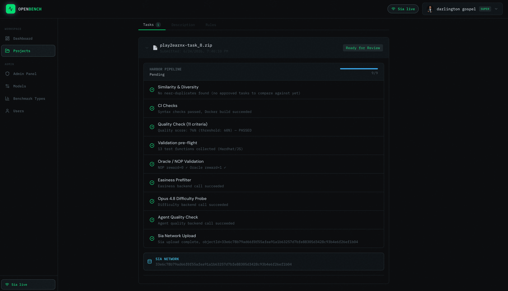

<p align="center">
  
</p>

# OpenBench

OpenBench is an AI dataset curation and evaluation platform. Each curated task is a realistic command-line challenge -- a broken build, a failing service, a bad config -- that AI agents solve through the terminal. A 9-stage automated pipeline verifies every submission for syntactic correctness, instructional quality, solvability, and calibrated difficulty before it enters the training data registry. Every approved task is a verified, production-grade training example; every dataset and artifact lives on the Sia Network forever. The same infrastructure also supports running benchmark evaluations.

---

## What it does

Submit a task ZIP and watch it move through 9 automated curation pipeline stages. Every approved task becomes a verified, production-grade training example for AI model training. Every task dataset, evaluation artifact, and result is content-addressed and stored permanently on the Sia Network. The same infrastructure can also be used to run benchmark evaluations against curated tasks, but the pipeline's primary mission is producing high-quality, certifiably valid training data.

```
Submit -> Similarity -> CI Checks -> Quality -> Preflight -> Oracle/NOP -> Easiness -> Difficulty -> Agent Quality -> Sia Upload -> Registry
```

Every stage is a durable Inngest function that survives crashes and restarts. Failed stages report exactly what to fix.

Stages 6 (Easiness) and 7 (Difficulty) use a CrewAI multi-agent probe: four sequential agents (Task Analyst -> Solution Architect -> Code Implementer -> Test Verifier) run in staggered parallel across 5 attempts. The easiness stage uses a fast/cheap model; the difficulty stage uses the frontier model. Early-exit logic cancels remaining runs the moment the outcome is decided, saving cost.

---

## Pipeline Stages

| # | Stage | What it does | Threshold |
|---|-------|-------------|-----------|
| 1 | Similarity & Diversity | Embedding + cosine comparison against approved tasks | cosine > 0.85 -> rejected |
| 2 | CI Checks | Bash syntax, Python compilation, Docker build | All green |
| 3 | Quality | LLM-as-judge across 11 criteria (realism, clarity, verifiability) | Average >= 0.6 |
| 4 | Preflight | `pytest --collect-only` inside the built image | >= 6 test functions |
| 5 | Oracle / NOP | Two containers: NOP (tests alone must fail), Oracle (solve.sh + tests must pass) | NOP=0, Oracle=1 |
| 6 | Easiness | CrewAI multi-agent probe x5 using the easiness model (fast/cheap); exactly 1-4/5 must pass | 1-4/5 (0=TOO_HARD, 5=TOO_EASY) |
| 7 | Difficulty | CrewAI multi-agent probe x5 using the frontier model (strong); exactly 1-3/5 must pass | 1-3/5 (0=TOO_HARD, >3=TOO_EASY) |
| 8 | Agent Quality | LLM-as-judge on instruction realism, no leaked assertions, actionability | >= 70% |
| 9 | Sia Upload | Upload the approved task, its datasets, and all artifacts to Sia Network for immutable, content-addressed, decentralized storage | Upload succeeds |

---

## Stack

| Layer | Tech |
|-------|------|
| Frontend | Next.js 16, TypeScript, TailwindCSS |
| Backend | Python (FastAPI), SQLAlchemy, PostgreSQL |
| Event Pipeline | Inngest (durable functions) |
| Embeddings | Ollama (`nomic-embed-text`) |
| LLM Provider | OpenRouter (sole provider - DeepSeek, Claude, GPT, Gemini, Llama, and hundreds more via a single API key) |
| Multi-Agent Probes | CrewAI (sequential agents: Analyst -> Architect -> Implementer -> Verifier) |
| Storage | Sia Network via `@siafoundation/sia-storage` SDK |
| Metadata | Sia Indexd |
| Containerization | Docker (sibling containers on host daemon) |
| ORM | Prisma (frontend-owned schema) |
| Auth | NextAuth.js with Passkey (WebAuthn) support |

---

## Running It

### With Docker (recommended)

```bash
docker compose up --build
```

| Service | URL | Description |
|---------|-----|-------------|
| Frontend | http://localhost:3000 | Next.js dashboard |
| Backend | http://localhost:8000 | FastAPI pipeline executor |
| Inngest | http://localhost:8288 | Event-driven pipeline UI |
| PostgreSQL | localhost:5432 | Database |
| Ollama | localhost:11434 | Local embeddings |

**No environment variables needed.** All configuration is handled through the browser-based Setup Wizard on first boot. Open http://localhost:3000 and complete the 4-step wizard:

1. **Sia Storage** -- Configure your Sia indexer URL, App ID, and BIP-39 recovery phrase, then approve the connection via the generated approval URL.
2. **OpenRouter API Key** -- Set your API key (get one at https://openrouter.ai/keys). All LLM calls route through OpenRouter.
3. **Social Login Providers** -- Optionally configure Google/GitHub OAuth and WebAuthn passkey settings.
4. **Sign Up** -- Create your account. The first user to sign up becomes the **super admin**.

Steps are persisted to the database -- you can close and resume later. After completing the wizard you'll be redirected to the dashboard.

When the backend boots it eagerly initialises the Sia client. If Sia is unreachable or unapproved, it gracefully falls into **demo mode**. Uploads and pipeline stages are simulated with realistic delays. The UI is identical either way; the mode badge in the top nav tells you which you're in.

---

### Without Docker (development)

#### 1. Environment variables

Create your local env files:

```bash
# Frontend -- only the database URL is required (everything else has defaults)
cat > frontend/.env << 'ENV'
DATABASE_URL=postgresql://<username>:<password>@localhost:5432/<database_name>
INNGEST_DEV=1
INNGEST_EVENT_KEY=local
INNGEST_SIGNING_KEY=local
INNGEST_BASE_URL=http://localhost:8288
NEXT_TELEMETRY_DISABLED=1
BACKEND_URL=http://localhost:8000
ENV

# Backend -- use the example as-is (or tweak ports)
cat > backend/.env << 'ENV'
DATABASE_URL=postgresql+asyncpg://<username>:<password>@localhost:5432/<database_name>
CORS_ORIGINS=["http://localhost:3000"]
OLLAMA_BASE_URL=http://localhost:11434
BACKEND_URL=http://localhost:8000
PORT=8000
ENV
```

That's it. The frontend `.env` above is the complete set of variables needed for local development. The backend `.env.example` contains defaults for the remaining backend-specific variables (PostgreSQL, CORS, Ollama, port) -- adjust as needed.

#### 2. Start services individually

> **Prerequisite:** Dev mode requires **PostgreSQL** and **Ollama** already running on your machine. Make sure both are up before starting the application servers. If you don't have them running yet, start them first:

```bash
# Terminal 1 -- PostgreSQL
docker run -d --name openbench_pg \
  -e POSTGRES_USER=<username> \
  -e POSTGRES_PASSWORD=<password> \
  -e POSTGRES_DB=<database_name> \
  -p 5432:5432 \
  postgres:16-alpine

# Terminal 2 -- Ollama
docker run -d --name openbench_ollama \
  -p 11434:11434 \
  -v ollama_data:/root/.ollama \
  ollama/ollama:latest

# Pull the embedding model
docker exec openbench_ollama ollama pull nomic-embed-text:latest
```

Once PostgreSQL and Ollama are confirmed running, start the remaining services in separate terminals:

```bash
# Terminal 3 -- Inngest
npx inngest-cli@latest dev \
  -u http://localhost:3000/api/inngest \
  --no-discovery --no-poll --persist

# Terminal 4 -- Backend
cd backend
python -m venv venv && source venv/bin/activate
pip install -r requirements.txt
uvicorn app.main:app --host 0.0.0.0 --port 8000 --reload

# Terminal 5 -- Frontend
cd frontend
npm install
npm run dev
```

| Service | URL |
|---------|-----|
| Frontend | http://localhost:3000 |
| Backend | http://localhost:8000 |
| Inngest | http://localhost:8288 |

**First boot:** Open http://localhost:3000 and complete the **Setup Wizard** (Sia -> OpenRouter -> Social Providers -> Sign Up). See the Docker section above for details on each step.

#### 3. Setup wizard (environment variables it saves)

The wizard persists configuration into the database via these API endpoints:

| Step | Endpoint | What it stores |
|------|----------|---------------|
| Sia | `POST /api/setup/sia` | Indexer URL, App ID, App Name, App Description, recovery phrase |
| Sia check | `POST /api/setup/sia/check` | Polls for approval completion |
| OpenRouter | `POST /api/setup/openrouter` | API key (encrypted in `AppSettings`) |
| Providers | `POST /api/setup/providers` | OAuth client IDs/secrets, WebAuthn RP ID & Origin |

All values are stored in the `AppSettings` database table and read back on subsequent visits.

---

### Stopping

- **Docker:** `docker compose down`
- **Manual:** Press `Ctrl+C` in each terminal. Data persists in `backend/data/` (Sia keys) and Docker volumes (Postgres data, Ollama models).

---

## Connecting a Real Sia Indexer

The Sia SDK requires a one-time approval flow. This is handled entirely through the **Setup Wizard** at `http://localhost:3000/setup` on first boot:

1. Enter your Sia indexer URL (default `https://sia.storage`), a 32-byte hex App ID (click **Generate** to create one), and your App Name.
2. Optionally provide a BIP-39 recovery phrase (your master key -- used once to derive the App Key, never stored by the app). Leave blank to have one auto-generated.
3. Click **Start Sia registration**. The backend saves the configuration and returns an approval URL.
4. Open that URL in your browser and approve the connection.
5. Click **"I've approved it"** to confirm. The backend derives and stores an App Key in `appkey.hex`. Subsequent boots reuse it automatically.

If you skip the wizard or Sia is unreachable, the platform runs in **demo mode** with simulated uploads -- no action required.

**Recovery phrase:** If you didn't provide one, on first boot the backend auto-generates a BIP-39 recovery phrase and writes it to `phrase.enc` inside the data directory. In a production app you'd ask the user for their own phrase and never store it. For this demo, automatic generation keeps the setup frictionless.

---

## Authoring a Task

Each task is a ZIP archive with this structure:

```
task-name/
├── instruction.md          # The problem statement (natural language, like explaining to a teammate)
├── task.toml               # Metadata: working_dir, network_required, test_runner
├── environment/
│   └── Dockerfile          # The broken environment the agent must fix
├── solution/
│   └── solve.sh            # The oracle fix, tests must fail before this runs
└── tests/
    ├── test.sh             # Test harness entrypoint
    ├── test_*.py           # Python test functions (or JS/Hardhat equivalents)
    └── ...
```

**Contract:**
- `test.sh` MUST write a reward to `$REWARD_FILE` (injected as `/logs/verifier/reward.txt`)
  - NOP run (no solution): must write `0`
  - Oracle run (after `solve.sh`): must write `1`
- At least 6 test functions required (Python `def test_*` or JS `it(...)`/`test(...)`)
- No self-reporting, the verifier writes the result

---

## Running a Benchmark Evaluation

Because every curated task is a verified, executable training example, the same infrastructure also supports running benchmark evaluations against those tasks:

1. All pipeline stages pass, including the Sia upload (Stage 9). A human reviewer then approves the task for the registry.
2. Configure a model via OpenRouter in the admin dashboard (the sole LLM provider, any model available on OpenRouter can be used). This avoids the technical debt of building separate integration modules for each LLM and lets you swap between Claude Opus, GPT, DeepSeek, Grok, and others from the UI with no backend changes.
3. Start a benchmark run. The agent gets an isolated Docker container with the broken environment.
4. After execution, the verifier checks `reward.txt` and the result, along with all evaluation artifacts, is uploaded to the Sia Network for permanent, decentralized storage.

---

## Project Layout

```
openbench/
├── .env.example                  # Root environment variables
├── .gitignore
├── docker-compose.yml            # 6-service orchestration
├── Note.txt                      # Dev commands reference
├── README.md
├── backend/
│   ├── Dockerfile
│   ├── requirements.txt
│   ├── .env.example
│   ├── data/                          # Sia app keys, certificates, local storage
│   └── app/
│       ├── main.py                    # FastAPI server with lifespan Sia init
│       ├── core/
│       │   ├── config.py              # Pydantic settings (env-based)
│       │   └── database.py            # Async SQLAlchemy session
│       ├── models/
│       │   └── orm.py                 # SQLAlchemy ORM models
│       ├── routers/
│       │   ├── approve.py             # Task approval (Sia upload already completed in pipeline)
│       │   ├── model_config.py        # Model provider configuration router
│       │   ├── pipeline.py            # Pipeline stage endpoints
│       │   ├── runs.py                # Benchmark run reads + log streaming
│       │   ├── sia.py                 # Sia connection status
│       │   └── tasks.py               # Task reads (debugging)
│       ├── schemas/
│       │   └── schemas.py             # Pydantic request/response models
│       └── services/
│           ├── agent_prompt.py        # LLM prompt building (initial + continuation)
│           ├── agent_quality.py       # LLM-as-judge for instructions
│           ├── crew_agent.py          # CrewAI multi-agent probe (Analyst -> Architect -> Implementer -> Verifier)
│           ├── difficulty.py          # Stage 7 - difficulty probe (frontier model, 5 runs, 1-3/5 pass)
│           ├── easiness.py            # Stage 6 - easiness prefilter (fast model, 5 runs, 1-4/5 pass)
│           ├── llm.py                 # Unified LLM provider abstraction (OpenRouter only)
│           ├── model_config.py        # Provider configuration logic + DB role-based model lookup
│           ├── pipeline.py            # Docker container execution (6 pipeline stages)
│           ├── probe_base.py          # Shared probe infrastructure: concurrency locks, staggered-parallel execution, early-exit, CrewAI/legacy dispatch
│           ├── probe_types.py         # Probe type definitions
│           ├── quality.py             # 11-criteria quality assessment
│           ├── sia_client.py          # Sia SDK singleton + demo fallback
│           ├── sia.py                 # Sia upload orchestration
│           ├── similarity.py          # Embedding-based similarity check
│           └── sse.py                 # Server-sent events for live pipeline status
├── frontend/
│   ├── Dockerfile
│   ├── entrypoint.sh                  # Docker container entrypoint
│   ├── .env.example
│   ├── next.config.ts
│   ├── next-env.d.ts
│   ├── tailwind.config.ts
│   ├── tsconfig.json
│   ├── package.json
│   ├── postcss.config.js
│   ├── public/
│   │   └── .gitkeep
│   └── src/
│       ├── proxy.ts                   # Next.js middleware (auth redirects, route protection)
│       ├── app/
│       │   ├── globals.css            # Global styles
│       │   ├── layout.tsx             # Root layout with NavBar
│       │   ├── page.tsx               # Landing page
│       │   ├── login/
│       │   │   └── page.tsx           # Login page (passkey authentication)
│       │   ├── dashboard/
│       │   │   └── page.tsx           # Main dashboard
│       │   ├── unauthorized/
│       │   │   └── page.tsx           # Unauthorized access page
│       │   ├── setup/
│       │   │   └── page.tsx           # First-run setup wizard (Sia -> OpenRouter -> Providers -> Sign Up)
│       │   ├── projects/
│       │   │   ├── page.tsx           # Project listing
│       │   │   ├── new/
│       │   │   │   └── page.tsx       # Create new project (with benchmark type selector)
│       │   │   └── [id]/
│       │   │       ├── page.tsx       # Project detail
│       │   │       └── submit/
│       │   │           └── page.tsx   # Task submission
│       │   ├── admin/
│       │   │   ├── page.tsx           # Admin dashboard (benchmark cards, Sia pipeline accordion)
│       │   │   ├── benchmark-types/
│       │   │   │   └── page.tsx       # Admin benchmark type management (activate/deactivate, sort)
│       │   │   ├── environment/
│       │   │   │   └── page.tsx       # Admin environment configuration page
│       │   │   ├── misc/
│       │   │   │   └── page.tsx       # Admin misc settings
│       │   │   ├── models/
│       │   │   │   └── page.tsx       # Model provider configuration page
│       │   │   └── users/
│       │   │       └── page.tsx       # Admin user management (role assignment)
│       │   ├── settings/
│       │   │   └── passkeys/
│       │   │       └── page.tsx       # Passkey management
│       │   ├── whitepaper/
│       │   │   └── page.tsx           # Whitepaper / about page
│       │   └── api/                   # Next.js API routes
│       │       ├── admin/
│       │       │   ├── benchmark-types/  # Admin benchmark types CRUD
│       │       │   ├── environment/      # Admin environment API routes
│       │       │   ├── projects/
│       │       │   │   └── members/      # Project member management
│       │       │   ├── ready-tasks/      # Tasks ready for approval
│       │       │   ├── settings/         # Admin settings
│       │       │   ├── stats/            # Dashboard statistics
│       │       │   └── users/            # User listing (admin)
│       │       ├── auth/
│       │       │   ├── [...nextauth]/    # NextAuth.js handler
│       │       │   └── passkey/
│       │       │       ├── authenticate/ # Passkey authentication
│       │       │       ├── register/     # Passkey registration
│       │       │       └── register-first/ # First-time passkey setup
│       │       ├── benchmark-types/  # Public endpoint for active benchmark types
│       │       ├── health/           # Health check
│       │       ├── inngest/          # Inngest handler
│       │       ├── models/           # Model provider listing
│       │       │   └── config/       # Model provider config CRUD
│       │       ├── projects/         # Project CRUD + task management
│       │       │   └── [id]/tasks/[taskId]/
│       │       │       ├── route.ts      # Task-level CRUD
│       │       │       ├── approve/      # Approve task
│       │       │       ├── reject/       # Reject task
│       │       │       ├── revert/       # Revert task to previous stage
│       │       │       └── runs/         # Task benchmark runs
│       │       ├── runs/             # Benchmark run state
│       │       │   └── [id]/         # Individual run detail
│       │       ├── settings/
│       │       │   └── passkeys/     # User passkey CRUD
│       │       │       └── [id]/     # Individual passkey operations
│       │       ├── setup/            # Setup wizard API
│       │       │   ├── status/       # Setup status + complete flag
│       │       │   ├── sia/          # Sia registration (POST) + approval check
│       │       │   ├── sia/check/    # Sia approval check
│       │       │   ├── openrouter/   # OpenRouter API key save
│       │       │   └── providers/    # OAuth / WebAuthn config save
│       │       ├── sia/
│       │       │   ├── status/       # Sia connection status
│       │       │   └── events/       # Sia SSE event stream
│       │       └── tasks/            # Task CRUD
│       │           └── [id]/         # Single task operations
│       ├── components/
│       │   ├── NavBar.tsx
│       │   ├── ProjectCard.tsx
│       │   ├── LogTerminal.tsx
│       │   ├── PipelineStages.tsx
│       │   ├── ScoreDisplay.tsx
│       │   ├── SessionProviderWrapper.tsx
│       │   ├── StatusBadge.tsx
│       │   ├── TaskActions.tsx
│       │   ├── TaskRow.tsx
│       │   ├── MarkdownEditor.tsx       # Lightweight markdown editor with live preview
│       │   ├── SideBar.tsx              # Collapsible sidebar navigation with Sia status indicator
│       │   ├── ProjectTypeSelector.tsx  # Benchmark type selector grid for project creation
│       │   ├── TagInput.tsx             # Tag input component with autocomplete suggestions
│       │   └── admin/
│       │       ├── BenchmarkCards.tsx
│       │       ├── SiaPipelineAccordion.tsx
│       │       └── SiaProof.tsx         # Sia upload proof visualisation
│       └── lib/
│           ├── admin-context.tsx
│           ├── pipeline-retry-context.tsx
│           ├── types.ts
│           ├── uploads.ts
│           ├── use-sia-sse.ts           # SSE hook for pipeline status
│           ├── auth/
│           │   ├── guards.ts            # Auth guards (isAdmin, isAuthenticated)
│           │   ├── index.ts             # Auth utilities
│           │   └── passkey.ts           # WebAuthn passkey helpers
│           ├── inngest/
│           │   ├── client.ts            # Inngest client
│           │   └── pipeline-inngest.ts  # 9-stage curation pipeline (stages + watchdogs)
│           └── prisma/
│               ├── client.ts
│               ├── index.ts
│               ├── schema.prisma
│               └── migrations/
```

---

## Architecture Notes

### Container Strategy

The backend runs inside Docker. To spin up task containers it uses the host Docker socket mounted at `/var/run/docker.sock`. Containers are launched as siblings on the host daemon (not children), with unique names derived from `taskId + stage` so parallel runs never collide. Containers are always removed after the stage completes.

### Pipeline Stage Contract

Each pipeline function receives `(taskId, storagePath)` and returns `(passed: bool, message: str)`. Stages are called by the Inngest function via HTTP POST to the backend's `/api/pipeline/{stage}` endpoints. Logs are written to `PipelineLog` in the database.

The pipeline runs 9 stages sequentially. If any stage fails, the task is marked `rejected` and the function stops. If all 9 pass (including Sia upload), the task moves to `pipeline_passed`, awaiting human approval. The Sia upload (Stage 9) is non-fatal: if it fails, the task is still `pipeline_passed` but `siaStatus` reflects the failure so admins can retry.

Two cron-based watchdog processes run alongside the pipeline:
- **pipeline-watchdog** (every 5 min): detects tasks stuck in `pipeline_running` for > 30 min, re-queues orphaned runs, and force-rejects tasks stuck > 2 hours.
- **cleanup-watchdog** (every hour): deletes local ZIP files, extracted directories, and Docker images for tasks rejected > 24 hours ago.

### Multi-Agent Probe Architecture (Stages 6 & 7)

Stages 6 (Easiness) and 7 (Difficulty) share a common probe infrastructure in `probe_base.py`:

- **Agent engine:** CrewAI (default) with a fallback legacy single-agent loop. The CrewAI pipeline runs four sequential agents per attempt: Task Analyst (analyses task files), Solution Architect (plans the fix), Code Implementer (executes commands), and Test Verifier (runs tests and reports pass/fail).
- **Staggered parallelism:** 5 runs launch in parallel with a 12-second stagger between each start, preventing rate-limit collisions.
- **Early-exit:** The moment the outcome is decided (e.g., 1 pass + 1 fail for easiness), remaining runs are cancelled to save cost.
- **Per-task locks:** An `asyncio.Lock` per task ID prevents concurrent probe executions from double-spending pipeline calls.
- **Model roles:** Each stage uses a different model from the DB, `easiness_model` (fast/cheap) for Stage 6, `frontier_model` (strong) for Stage 7. These are configured in the admin dashboard. All models are accessed through **OpenRouter**, the sole LLM provider.

### Sia Integration

- **Sia upload is Stage 9 of the pipeline.** Upload runs automatically as part of the curation pipeline, not during human approval. Human approval simply flips the task status to `approved`.
- **Setup wizard:** First-time Sia configuration is handled by the browser-based Setup Wizard at `/setup` (Sia indexer URL, App ID, recovery phrase, approval URL flow). Derived App Key stored in `appkey.hex`, automatic reconnection on restarts.
- **Demo mode:** If Sia is unreachable or the wizard is skipped, the platform gracefully falls back to simulated uploads with fake object IDs.
- **Results:** Every benchmark result artifact, along with all task datasets and evaluation outputs, is uploaded to Sia Network, immutable, content-addressed, publicly verifiable. Anyone can verify any result by fetching the corresponding CID from the network directly.

### File Upload Flow

1. User uploads a task ZIP via the frontend dashboard.
2. Frontend writes the ZIP to a shared `task_uploads` Docker volume.
3. An Inngest event (`pipeline/task.submitted`) triggers the 9-stage curation pipeline.
4. Each stage calls the backend API, which reads the ZIP from the shared volume.
5. After all 9 stages pass (including Sia upload), a human reviews and approves the task for the registry. The task ZIP, all associated datasets, and benchmark artifacts remain permanently on the Sia Network.

### Authentication & Authorization

- **Passkey-first:** Uses WebAuthn for passwordless authentication via passkeys (Touch ID, Face ID, security keys).
- **NextAuth.js:** Session management with JWT strategies, passkey credentials stored in the database.
- **Role-based access:** Three tiers: `user` (basic access), `admin` (project management), `super_admin` (model config, benchmark types, user management).
- **Middleware:** Route protection via `proxy.ts`. Unauthenticated users are redirected to `/login`, non-admin users to `/unauthorized`.
- **Sidebar navigation:** Collapsible rail that adapts to user role. Admins see Projects and Admin Panel; super admins additionally see Models, Benchmark Types, and Users management.
- **Setup wizard first:** The first user to complete the Setup Wizard and sign up becomes the **super admin** automatically.

### Benchmark Types

Projects are categorized by benchmark type (e.g., Coding & Software, Mathematical Reasoning, Agentic Tool Use). Types are managed by super admins in the admin dashboard. They can activate/deactivate types and control sort order. Only active types appear in the project creation form's type selector.

---

## Future Plans

After the initial launch milestone, the focus will shift to broadening the types of training data and evaluations the platform supports. The current terminal-based format is well suited for software engineering and coding training examples, but the curation infrastructure is designed to be extensible. The following training data categories are planned:

| Category | Description |
|----------|-------------|
| Coding & Software | The current focus: terminal-based software engineering challenges with broken builds, misconfigured services, and failing tests. |
| General Knowledge | Training examples that test a model's breadth of factual knowledge across domains, with verifiable answer keys. |
| Mathematical Reasoning | Multi-step math problems, proofs, and quantitative reasoning training examples with deterministic grading. |
| Multimodal | Training data combining images, code, and text inputs that require understanding across modalities. |
| Agentic & Tool Use | Training examples requiring agents to interact with APIs, databases, browsers, and other external tools to accomplish goals. |
| Long-Context & Retrieval | Training examples that test a model's ability to handle large contexts, retrieve relevant information, and reason across long documents. |
| Safety & Alignment | Red-teaming, prompt injection detection, and alignment training examples with structured scoring rubrics. |
| Instruction Following | Training examples that test how precisely a model follows multi-part, constrained instructions with clear success criteria. |
| Domain-Specific | Specialized training data for fields like medicine, law, finance, and engineering with expert-validated ground truth. |
| Creative & Open-Ended | Training examples evaluating creative writing, brainstorming, and open-ended problem solving with structured evaluation. |
| Efficiency & Deployment | Training data measuring inference speed, memory usage, token efficiency, and deployment characteristics. |

Each category will require its own task format specification, quality criteria, and calibration thresholds, but the core pipeline and verification infrastructure will remain shared. All datasets and artifacts across every category will be permanently archived on the Sia Network and will serve primarily as training data, with the same examples also available for use as benchmarks.

---

## License
OpenBench is released under the [MIT License](./LICENSE).

---

*Built in the open. Training examples are reproducible, shareable, and forkable. Anyone can run the same curation pipeline and verify the results for themselves.*
